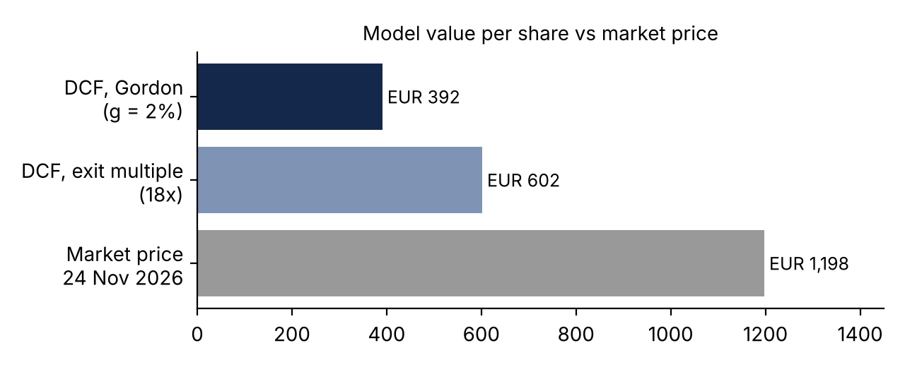
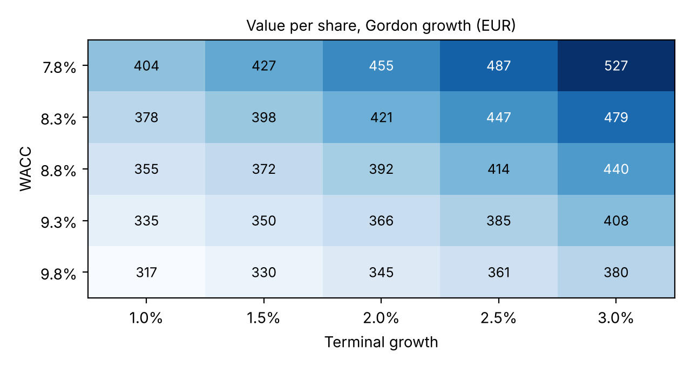

# ASML DCF Valuation

Linked three-statement model (income statement, balance sheet, cash flow) and a five-year DCF for ASML Holding N.V. (EUR, US GAAP). Built in Excel with live formulas.

**Full report (PDF):** [`docs/ASML_DCF_Report.pdf`](docs/ASML_DCF_Report.pdf) | **Model:** [`model/ASML_DCF_Model.xlsx`](model/ASML_DCF_Model.xlsx)

## Result

| Method | Enterprise value | Value per share | vs price (EUR 1,198, 24 Nov 2026) |
|---|---|---|---|
| Gordon growth (g = 2.0%, WACC 8.8%) | EUR 139.4bn | EUR 392 | -67% |
| Exit multiple (18x EV/EBITDA, FY2030E) | EUR 220.1bn | EUR 602 | -50% |

This is what the stated assumptions imply, not a recommendation. The market price corresponds to about 36x trailing EV/EBITDA, i.e. growth far beyond the fade to 2% assumed here.

## Model structure

`About | Assumptions | IS | BS | CF | WACC | DCF | Checks`

- Colour code: blue = input, black = formula, green = cross-sheet link. All forecast drivers are on `Assumptions`, each with a rule and a reason.
- Cash is the balancing item from the cash flow statement; the balance sheet balances in every forecast year.
- `Checks` ties model totals to reported FY2023-25 totals (differences are zero), tests terminal value share of EV and shows the implied exit multiple / implied growth.

## Key assumptions

| Driver | Forecast | Basis |
|---|---|---|
| Net sales growth | 7.2% fading to 2.0% | FY2023-25 CAGR as start, fades to terminal growth |
| Gross margin / R&D / SG&A | 51.8% / 14.7% / 4.0% | 3-year averages |
| Tax rate | 17.3% | 3-year average |
| Capex / D&A (% of sales) | 6.7% / 3.1% | 3-year average / FY2025A |
| WACC | 8.77% | CAPM: Bund 3.26%, ERP 4.17% (Damodaran), beta 1.33 |

## Limitations

- Valuation date 31 Dec 2025 vs share price of 24 Nov 2026; value is not rolled forward.
- Basic share count (383.1m); diluted count not sourced.
- Terminal value is 73% (Gordon) and 83% (exit multiple) of EV.
- One operating case; sensitivity only on WACC vs terminal growth; no bull/bear scenarios.
- Risk-free rate, beta, share price and peer multiples are from aggregators and date-stamped in the notes columns.
- Built by me with AI tools for coaching and review; assumptions and structure were chosen and checked by me.

## Sources

ASML 6-K filings (SEC EDGAR, CIK 937966), ASML Q4/FY2025 press release (28 Jan 2026), Damodaran ERP, Trading Economics, StockAnalysis, Euronext Amsterdam. Not investment advice.
